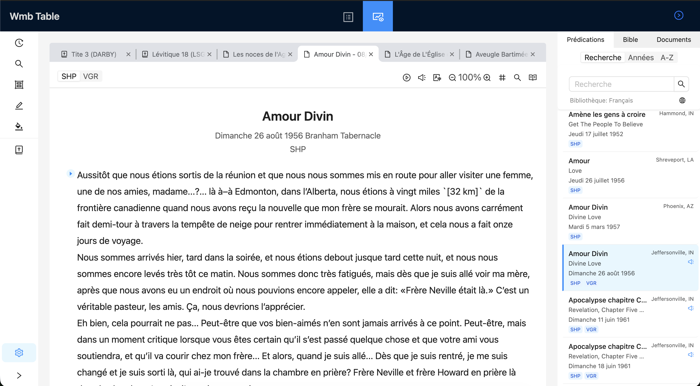

# Wmb Table

<div align="center">
    
</div>

Wmb Table is a free desktop app for Windows, macOS and Linux to read and study the sermons of William Marrion Branham. It brings together about 1,200 sermons in many languages, the Bible, full-text search, notes, subjects, highlights and audio in one place, with an optional AI assistant that develops a study topic with references you can check.

<picture>
    <source media="(prefers-color-scheme: dark)" srcset="docs/.vitepress/theme/assets/screenshot-dark.png" />
    
</picture>

## Features

**Library and reading**

- About 1,200 sermons, with translations in 80+ languages. Each language is a downloadable pack.
- Read several documents at once in tabs. The app remembers where you stopped in each one.
- Switch between the available translations of a sermon, change the text size and search inside the open document.
- Find sermons similar to the one you are reading.

**Search**

- Fast full-text search across the whole library (powered by Tantivy).
- Search modes: all words, any word, or exact phrase, with typo tolerance.

**Bible**

- King James Version and Louis Segond included. More versions can be downloaded.

**Study tools**

- Notes with a rich text editor. Insert sermon and Bible references, then export a note to PDF or Word (DOCX).
- Subjects to collect passages on a theme.
- Highlights in color, with an optional comment, and a page to review them all.
- Reading history.

**Audio**

- Play the original sermon audio when it exists.
- Have any text read aloud. Voices: system voices, Sherpa-ONNX (offline, downloaded once), Microsoft Edge (free, online), and Cartesia, ElevenLabs or OpenAI (with your own account).

**AI assistant (optional)**

- A study companion: ask about a topic and it develops it, brings together what the sermons and the Scriptures say, and gives clickable references so you can check for yourself.
- It can also create notes and subjects for you.
- Bring your own provider: OpenRouter, OpenAI, Google Gemini, Anthropic Claude, Ollama (on your computer or in the cloud), or any OpenAI-compatible service.

**MCP server (optional)**

- Lets your own AI app (Claude Code, Codex, Claude Desktop) use your Wmb Table library.
- Off by default. It only listens on your computer (`127.0.0.1`) and is read-only unless you allow changes.

**And also**

- Import your own documents: PDF, Word (DOCX), EPUB, Markdown and plain text.
- Google Drive sync for notes, subjects, highlights, custom documents and AI conversations.
- Interface in French, English, Spanish, Portuguese and Swahili.
- Light and dark themes.
- Automatic updates.

## Download

Get the latest version from the [releases page](https://github.com/paradoxe35/wmb-table/releases/latest).

| System  | Files                                                 |
| ------- | ----------------------------------------------------- |
| Windows | Installer (`.exe`) or `.zip`, x64                     |
| macOS   | `.dmg`, Apple Silicon (arm64) and Intel (x64)         |
| Linux   | `.AppImage`, `.deb`, `.rpm` or `.pacman` package, x64 |

The [installation guide](https://wmb-table.web.app/en/guide/installation) explains each step.

## Links

- Website: [wmb-table.web.app](https://wmb-table.web.app/)
- User guide: [wmb-table.web.app/en/guide/interface-overview](https://wmb-table.web.app/en/guide/interface-overview) (also in French and Spanish)
- Privacy policy: [wmb-table.web.app/en/privacy](https://wmb-table.web.app/en/privacy)
- Releases: [github.com/paradoxe35/wmb-table/releases](https://github.com/paradoxe35/wmb-table/releases)

## Development

Built with Electron 45, React 19, Ant Design 6, Zustand, the Vercel AI SDK 7, SQLite (better-sqlite3 + Drizzle ORM), Tantivy, sherpa-onnx and the MCP SDK. Built with electron-vite and electron-builder, tested with Vitest.

You need Node.js 20 or newer and pnpm 9 or newer.

```bash
git clone https://github.com/paradoxe35/wmb-table.git
cd wmb-table
pnpm install
pnpm dev               # run the app in development mode
pnpm test              # unit and integration tests
pnpm lint              # ESLint (also: pnpm typecheck, pnpm format:check)
pnpm build             # build the app into out/
pnpm package           # make installers for this system in release/
pnpm docs:dev          # run the website and user guide locally
```

`pnpm test:e2e` runs end-to-end tests against the built app (run `pnpm build` first). On Linux it needs Xvfb (`xvfb-run`).

## License

Wmb Table is open source under the MIT license.
